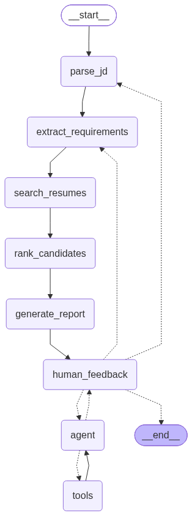
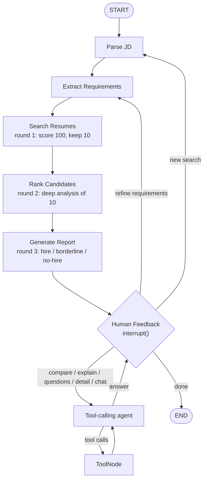

# Agentic Profile Matching (Milestone 3)

A LangGraph agent that screens 100 resumes against a job description, explains every ranking, and lets a recruiter refine the search in conversation. It builds on the Milestone 1 file tools (`fs_tools.py`) and the Milestone 2 RAG matcher (`resume_rag.py`, `job_matcher.py`).

## State machine





The diagram is generated from the compiled graph by `python draw_graph.py`, which writes `docs/state_machine.png` and `docs/state_machine.mmd`.

- `human_feedback` pauses the graph with LangGraph's `interrupt()`. A `MemorySaver` checkpointer keeps the state between turns, and each reply resumes the graph with `Command(resume=text)`.
- The router in `human_feedback` classifies each message as one of eight intents: `refine`, `new_search`, `compare`, `explain`, `questions`, `candidate_detail`, `chat`, or `done`. It uses the LLM with structured output and falls back to keyword rules.
- `refine` goes back through the pipeline, so the agent re-ranks and the new report explains what moved. Questions go to a ReAct-style agent (`bind_tools` plus `ToolNode`) that loops until it can answer, then returns to `human_feedback`.

## Agent state

Defined in `matching_agent.py`, `MatchState`:

| Field | Purpose |
|---|---|
| `messages` | Conversation history (`add_messages` reducer): user turns, reports, tool calls, tool results |
| `trace` | One line of reasoning per node, shown in the CLI and in Streamlit |
| `jd_text`, `requirements` | The job description and its parsed form: title, must-have, nice-to-have, minimum years |
| `requirement_history`, `previous_requirements` | Every requirement version, used to explain changes |
| `pool_size`, `qualified`, `round1` | Round 1: how many resumes were screened, how many meet every hard requirement, the top 10 |
| `shortlist` | Rounds 2 and 3: evidence, strengths, gaps, analyst note, verdict, and suggestions per candidate |
| `previous_shortlist`, `ranking_changes` | The ranking before the last refinement and what moved and why |
| `report_path`, `report_version` | Markdown report written to `reports/<role>_v<n>.md` |
| `intent`, `turn_start` | The router's decision and where the current turn starts in `messages` |

## Tools

All in `agent_tools.py`. Tools that need the current search read it from graph state through `InjectedState`.

| Tool | Source |
|---|---|
| `list_files`, `read_file`, `search_in_file`, `write_file` | Milestone 1 `fs_tools.py` |
| `rag_search(query, k)` | Milestone 2 Chroma index (section-level MiniLM embeddings) |
| `extract_requirements(jd)` | Must-have vs nice-to-have skills and minimum years (LLM structured output, rule fallback) |
| `compare_candidates(candidate_ids)` | Head-to-head score breakdown, skills, years, strengths, gaps, verdict |
| `explain_ranking(higher, lower)` | Point-by-point reason one candidate outranks another |
| `generate_interview_questions(candidate_id)` | Questions that verify strengths and probe gaps |
| `get_candidate_report(candidate_id)` | Full match report for one candidate, with improvement suggestions |

Tools accept ids (`meera_krishnan`), full names, first names, or ranks (`#2`).

## Multi-round screening and explainability

1. **Initial screen** (`search_resumes`): every resume is scored with the hybrid matcher. Score = 60 x calibrated semantic similarity + 25 x share of the job's skills + 15 x years ratio. Each missing must-have costs 15 points, and being below the years bar costs 10 plus 5 per missing year. Near misses therefore rank lower instead of vanishing, so borderline candidates can be discussed. The top 10 move on.
2. **Deep analysis** (`rank_candidates`): each of the 10 resumes is read in full with `read_file`. `search_in_file` pulls an evidence line for every required skill. Rule-based strengths and gaps are combined with LLM analyst notes (one batched call).
3. **Recommendation** (`generate_report`):
   - **Hire:** every must-have, the years bar, and a score of 65 or more.
   - **Borderline:** every hard requirement met but a score below 65, or exactly one gap (one missing must-have, or up to 2 years short) with a score of 35 or more.
   - **No-hire:** everyone else.

   Borderline candidates get concrete improvement suggestions.

Scores and verdicts are deterministic. The LLM extracts requirements, applies requirement changes, routes messages, writes analyst notes and interview questions, and narrates explanations, but it never changes a score. That is why "Why did X rank higher than Y?" can be answered point by point. If the model is unavailable, every step falls back to rules (`USE_LLM=0`).

## Setup

Python 3.10 or newer (built with 3.11). All commands run from the `agentic-profile-matching` folder.

```bash
git clone https://github.com/Nagaraj172004/agentic-profile-matching.git
cd agentic-profile-matching
```

Windows (PowerShell):

```powershell
py -3.11 -m venv .venv
.\.venv\Scripts\Activate.ps1
pip install -r requirements.txt
copy .env.example .env
```

macOS / Linux:

```bash
python3.11 -m venv .venv
source .venv/bin/activate
pip install -r requirements.txt
cp .env.example .env
```

Then, on any OS:

```bash
# put your Groq key in .env first
python generate_resumes.py  # 100 resumes (txt/docx/pdf) and 6 job descriptions
python resume_rag.py        # builds the Chroma index (downloads all-MiniLM-L6-v2 on first run)
python draw_graph.py        # optional: regenerate the diagram
```

### HTTPS certificates

Certificate verification stays on for every request: Groq, the Hugging Face model download, and mermaid.ink. `tls.py` uses [truststore](https://pypi.org/project/truststore/) so Python checks certificates against the operating system's trust store instead of only its bundled CA list. On networks that inspect HTTPS (corporate proxies, antivirus web shields), the inspecting root certificate is usually in the OS store already, so requests verify without any code that skips checks.

Get a free key at [console.groq.com/keys](https://console.groq.com/keys). The default model is `openai/gpt-oss-120b`; override it with `GROQ_MODEL` in `.env`. The free tier allows about 200K tokens per day per model, and one full run of the six test scenarios uses most of that. If you hit the limit, set `GROQ_MODEL=openai/gpt-oss-20b`, which has its own quota and passes the same scenarios.

## Run

```powershell
python chat_cli.py                          # terminal chat with live reasoning trace
python chat_cli.py jobs/frontend_react.txt  # start from a job file
streamlit run app.py                        # web chat with reasoning panel, shortlist, report download
```

The first turn in a new process takes longer because the embedding model loads. Later turns reuse it. In Streamlit, `.streamlit/config.toml` turns off the file watcher; otherwise it walks every `transformers` submodule and stalls the app.

Example conversation:

```text
You: Find me candidates with React and 3+ years experience
You: Compare the top 3 matches side by side
You: Why did Fiona rank higher than Rhea?
You: Make Jest a must-have and raise the minimum to 5 years
You: Generate interview questions for Rhea Banerjee
You: How could Gopal Krishnan improve?
You: done
```

## Test scenarios

```powershell
python test_scenarios.py            # all six against the Groq model
python test_scenarios.py 3          # one scenario
python test_scenarios.py --offline  # rule-based fallbacks only
```

Each scenario asserts on graph state and tool use, and writes a transcript with the agent's reasoning to `transcripts/`.

| # | Flow | Checks |
|---|---|---|
| 1 | `jobs/senior_python_backend.txt`, then `done` | 100 screened, 10 deep-analysed, every candidate has a verdict, report saved, Nagaraj (4 of 5 years) is borderline with a suggestion, graph reaches END |
| 2 | "Find me candidates with React and 3+ years experience", then "Compare the top 3" | Requirements parsed from free text, routed to compare, `compare_candidates` used, all three named |
| 3 | Frontend JD, "Make Jest a must-have and raise the minimum to 5 years", "Actually Jest is only nice-to-have" | Requirements updated each time, history kept, ranking re-ordered and the movement explained |
| 4 | Data engineer JD, "Why did #1 rank higher than #2?", "Why is #10 not a hire?" | `explain_ranking` used, both candidates named, gaps explained |
| 5 | ML JD, interview questions and improvement plan for a borderline candidate | 100 -> 10 -> verdicts, `generate_interview_questions` used, suggestions present |
| 6 | "Rust and Haskell and 10+ years", "Compare John Doe and Jane Smith", "Drop Rust and Haskell, require Golang with 4+ years" | Nobody qualifies, unknown names handled without inventing anyone, relaxed search puts the two Golang engineers first |

## Layout

| File | Role |
|---|---|
| `matching_agent.py` | LangGraph state, nodes, router, agent, `build_graph()`, `MatchingSession` |
| `agent_tools.py` | Tools exposed to the agent |
| `screening.py` | Requirements, the three rounds, verdicts, ranking diffs, explanations, report |
| `llm.py` | Groq client (OpenAI-compatible) with optional fallback |
| `tls.py` | Certificate verification through the OS trust store |
| `chat_cli.py`, `app.py` | Terminal and Streamlit chat |
| `test_scenarios.py` | Six scripted conversations |
| `draw_graph.py` | Exports the state machine diagram |
| `fs_tools.py` | Milestone 1 file tools |
| `resume_rag.py`, `job_matcher.py` | Milestone 2 chunking, embeddings, Chroma, hybrid scoring |
| `dataset.py`, `generate_resumes.py` | 100 candidates and 6 jobs |

## Demo video outline (5-6 minutes)

1. **Architecture** (45 s): the state diagram, `MatchState`, and the tool list.
2. **Multi-round screening** (75 s): run `python chat_cli.py jobs/senior_python_backend.txt`. Walk through the trace lines for 100 -> 10 -> verdicts, then open the saved report and point out the score breakdown, evidence lines, and Nagaraj's borderline suggestion.
3. **Conversation** (60 s): "Compare the top 3 matches side by side", then "Why did <#1> rank higher than <#2>?". Show the tool calls in the trace and the point-by-point answer.
4. **Iterative refinement** (60 s): "Make Docker a must-have and require 7+ years". Show the requirement change, "How the ranking moved", and the new report version.
5. **Borderline candidates** (45 s): "Generate interview questions for <borderline>" and "How could <borderline> improve?".
6. **Streamlit and tests** (45 s): `streamlit run app.py` with the reasoning panel and sidebar, then the `test_scenarios.py` summary.

## Submit

Push this folder to GitHub. `.venv/`, `chroma_db/`, `.env`, and `reports/` are ignored. Transcripts in `transcripts/` are kept as evidence of the test runs. Record the demo separately and submit the video plus the repository link.
